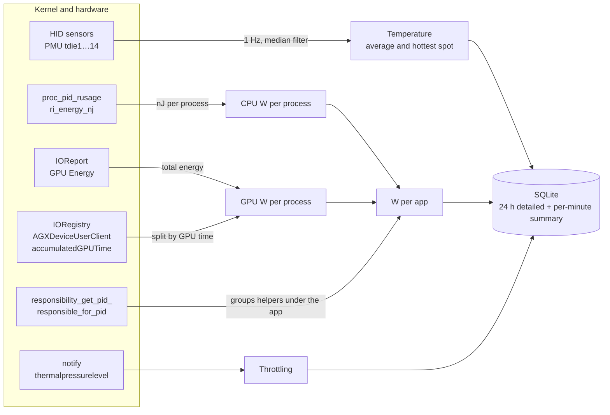

<p align="center">
  
</p>

<h1 align="center">TermoBar</h1>

<p align="center">
  <b>Find out which app is heating up your Mac — in watts, with history.</b>
</p>

<p align="center">
  <a href="https://github.com/gbrlrg/termo-bar/releases/latest"></a>
  
  
  <a href="LICENSE"></a>
</p>

<p align="center">
  <b>English</b> · <a href="README.pt-BR.md">Português</a>
</p>

TermoBar is a native menu bar app for Apple Silicon Macs. It shows the chip temperature in the menu bar and, when you click it, lines that temperature up with the energy each app is using: you see the spike on the chart and, right below, the app that caused it.

Unlike Activity Monitor's "Energy Impact", which is a relative score, TermoBar shows **real watts**, read from the kernel's energy counters, with CPU and GPU split apart and up to 90 days of history.

<p align="center">
  
</p>

<p align="center">
  
  &nbsp;&nbsp;
  
</p>

> [!NOTE]
> This is the first public release, and the app's interface is in Brazilian Portuguese. The software is provided as is, without warranty; see the [license](LICENSE). Found a problem? [Open an issue](https://github.com/gbrlrg/termo-bar/issues).

## Install

1. Download `TermoBar-<version>.dmg` from the [latest release](https://github.com/gbrlrg/termo-bar/releases/latest) and open it.
2. Drag **TermoBar** to **Applications** and open it from there. The temperature appears in the menu bar.

Requires an Apple Silicon Mac with macOS 15 or later. The app and the DMG are signed with a Developer ID and notarized by Apple, so they open without Gatekeeper warnings.

To update, download the new version and replace the app in Applications. Your history and settings are kept.

## What it shows

- **Chip temperature in the menu bar**, in °C or °F, with or without a decimal place.
- **macOS thermal state** — from *Normal* to *Throttling* — straight from the kernel's thermal pressure.
- **Temperature chart**, with the line colored by the temperature itself and throttling periods highlighted.
- **Energy per app** as stacked bars, on the same time axis as the temperature.
- **"Apps heating up the most" ranking**: average watts, share of energy, whether the GPU dominates, and a timeline of when each app was open and drawing power.
- **Each app's processes, right now**: click an app to see which of its processes are drawing power, with a readable name, project and how long they've been running (e.g. *wrangler · dev · my-site*, *Swift tests*, an app in the Simulator).
- **Time ranges** of 15 min, 1 h, 24 h and 7 days.
- **Alerts** for high temperature, throttling and apps using too much power.
- **CSV export** with CPU and GPU per app, reading by reading.

Hovering over the charts shows the values at that moment; hovering over an app highlights its color in the energy chart, and clicking it opens its processes.

## How each number is measured

Accuracy is the core of TermoBar. None of the measurements below needs an administrator password.



| Data | Source | How it's handled |
|---|---|---|
| **Chip temperature** | SoC die sensors (`PMU tdie*`) via `IOHIDEventSystemClient` | Read every second. Readings outside 10–130 °C or more than 25 °C off the median are discarded. Each record stores the average of the interval's readings (removes noise) and, separately, the hottest sensor (doesn't hide spikes). |
| **CPU per app** | The energy counter the kernel keeps for each process (`proc_pid_rusage`, `ri_energy_nj`) | Physical nanojoules — not Activity Monitor's relative "Energy Impact". The difference between two readings divided by the elapsed time gives watts. |
| **GPU per app** | Total GPU energy (`IOReport`, *GPU Energy* channel) + each process's GPU time (`AGXDeviceUserClient` → `accumulatedGPUTime`) | Energy is split in proportion to GPU time. WindowServer gets a correction (see below). |
| **Grouping by app** | `responsibility_get_pid_responsible_for_pid` | Each process counts toward the app responsible for it, as in Activity Monitor: browser helpers go to the browser, compilers launched from a terminal go to the terminal. |
| **Throttling** | `com.apple.system.thermalpressurelevel` notification | Five levels (nominal, moderate, heavy, critical, sleeping). From *heavy* on, macOS lowers the chip's frequency. |
| **Open and active apps** | `NSWorkspace` | Apps with a window/Dock icon and the frontmost app in each record. |

### The WindowServer correction

The GPU time macOS records includes time spent waiting in the queue. When another process keeps the GPU busy, WindowServer's time (it draws the screen) nearly triples without it using more energy — and a naive split would hand it almost half of the power actually used by whoever is driving the GPU.

TermoBar learns how much the GPU uses when only WindowServer is active and, under contention, caps WindowServer's share at 1.5× that value. The rest goes to the competing processes, in proportion to each one's GPU time.

### Validation

Measured on a MacBook with an Apple M5 running macOS 27:

| Test | Result |
|---|---|
| One performance core at 100% (`yes > /dev/null`) | **6.6 W** of CPU attributed to the process |
| Metal compute loop saturating the GPU (~17 W) | Naive split: 1.6–2.8 W for the workload and 8–13 W for WindowServer. **With the correction: 13–16 W for the workload and 1.5 W for WindowServer** |
| GPU energy counter lag | None: it rises and falls within the same half second as the load |
| TermoBar's own usage | **0.57%** of one core on average, under 5 mW |

### Known limits

- **CPU** for processes running as another user (kernel, WindowServer, root daemons) can't be read without privileges and is left out. Their **GPU** usage is counted.
- On macOS 27, IOReport without root only reports **GPU** energy; CPU and Neural Engine come back as zero. That's why CPU comes from the per-process counter.
- GPU per app is a corrected split, not a direct reading: macOS doesn't expose GPU energy per process.

## Settings

<p align="center">
  
  &nbsp;
  
</p>
<p align="center">
  
  &nbsp;
  
</p>

| Tab | Options |
|---|---|
| **General** (Geral) | Open at login, displayed temperature (chip average or hottest spot), unit (°C/°F), decimal places, recording interval (2/5/10 s) |
| **Menu bar** (Barra de menus) | Temperature only, temperature and watts, icon and temperature, or icon only; color when hot; show only the icon while cool |
| **Alerts** (Alertas) | Temperature above a threshold for 30 s; throttling; an app above X W on average for N minutes |
| **Sensors** (Sensores) | Live reading of each sensor, with a readable name and which ones count toward the average |
| **Data** (Dados) | Retention (7/30/90 days), CSV export, show in Finder, delete history |
| **Accuracy** (Precisão) | The methodology above, inside the app |
| **About** (Sobre) | Version, a link to the releases on GitHub and a button that copies system info for support requests |

## History and privacy

Everything stays on your Mac, in `~/Library/Application Support/TermoBar/history.sqlite`:

- **Detailed readings** (one record every 2–10 s) for 24 hours.
- **Per-minute summary** for the chosen period (7, 30 or 90 days).

No data leaves your computer. There's no telemetry, no account and no internet connection.

## FAQ

**Why isn't it on the Mac App Store?**
To measure each app's energy, TermoBar reads other processes' counters and uses private macOS APIs. The App Store requires the App Sandbox, which blocks both.

**Does it need an administrator password or a helper?**
No. Everything is read as a regular user; nothing is installed outside the app itself.

**How much battery does it use?**
0.57% of one core on average, under 5 mW.

**Why does the temperature differ from another app's?**
Each app picks different sensors. By default TermoBar shows the average of the chip's die sensors, which is the most stable; in Settings › General you can switch to the hottest spot, which reacts faster to spikes. The Sensors tab shows every reading.

**Does it work on Intel Macs?**
No. The sensors and counters it uses only exist on Apple Silicon.

**Why do some system processes show no CPU?**
macOS doesn't let a regular app read the CPU energy of processes owned by other users, such as the kernel and WindowServer. Their GPU usage is counted. See [Known limits](#known-limits).

## Uninstall

1. If it opens at login, turn that off first (gear › Abrir ao iniciar sessão).
2. Quit TermoBar: click the temperature in the menu bar, then the gear › Sair do TermoBar.
3. Delete `TermoBar.app` from Applications.
4. To also delete the history and settings:

```sh
rm -rf ~/Library/Application\ Support/TermoBar
defaults delete br.com.gbrlrg.termobar
```

## Building from source

See [docs/DEVELOPMENT.md](docs/DEVELOPMENT.md) (in Portuguese): building, testing, distributing and how the code is organized.

## License

The code is available under the [PolyForm Noncommercial 1.0.0](LICENSE) license: you may use, study, modify and redistribute TermoBar for **noncommercial** purposes (personal use, study, research, nonprofit organizations and public institutions). Commercial use is not allowed without written permission.

Because of this restriction, TermoBar is *source-available*, not open source as defined by the OSI.

Copyright © 2026 Gabriel Rigon.
