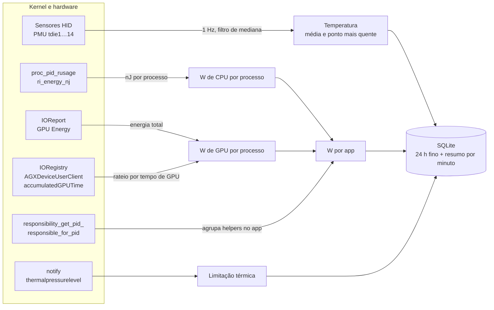

# TermoBar

**Descubra qual app está esquentando seu Mac — em watts, com histórico.**

TermoBar é um app nativo de barra de menus para Macs com Apple Silicon. Ele mostra a temperatura do chip na barra e, ao clicar, cruza essa temperatura com a energia que cada app está gastando: dá para ver o pico no gráfico e, logo abaixo, qual app causou.

<p align="center">
  
</p>

<p align="center">
  
  &nbsp;&nbsp;
  
</p>

> [!WARNING]
> **Beta.** O TermoBar está em fase de testes e pode ter erros, medir valores imprecisos ou mudar sem aviso. Ao usar, você participa como testador. O software é fornecido no estado em que se encontra, sem garantias; veja a [licença](LICENSE).

## Instalar

1. Baixe o `TermoBar-<versão>.dmg` da [última release](https://github.com/gbrlrg/termo-bar/releases/latest) e abra.
2. Arraste o **TermoBar** para **Aplicativos** e abra o app por lá. A temperatura aparece na barra de menus.

Requer um Mac com Apple Silicon e macOS 15 ou superior. O app e o DMG são assinados com Developer ID e notarizados pela Apple.

## O que ele mostra

- **Temperatura do chip na barra**, em °C ou °F, com ou sem casa decimal.
- **Estado térmico do macOS** — de *Normal* a *Limitando desempenho* — direto da pressão térmica do kernel.
- **Gráfico de temperatura** com a linha colorida pela própria temperatura e os trechos de limitação térmica destacados.
- **Energia por app** em barras empilhadas, no mesmo eixo de tempo da temperatura.
- **Ranking "Apps que mais aquecem"**: watts médios, fatia da energia, se a GPU pesa, e uma linha do tempo de quando cada app esteve aberto e consumindo.
- **Processos de cada app agora**: clicando num app, a lista mostra os processos dele que estão consumindo, com nome legível, projeto e há quanto tempo rodam (ex.: *wrangler · dev · Mindminer*, *Testes Swift*, um app no Simulador).
- **Períodos** de 15 min, 1 h, 24 h e 7 dias.
- **Alertas** de temperatura alta, limitação de desempenho e app gastando demais.
- **Exportação CSV** com CPU e GPU por app, leitura a leitura.

Passar o mouse sobre os gráficos mostra os valores do instante; passar o mouse num app destaca a cor dele no gráfico de energia, e clicar nele também abre os processos.

## Como cada número é medido

Precisão é o ponto central do TermoBar. Nenhuma das medições abaixo exige senha de administrador.



| Dado | De onde vem | Como é tratado |
|---|---|---|
| **Temperatura do chip** | Sensores do die do SoC (`PMU tdie*`) via `IOHIDEventSystemClient` | Lidos a cada segundo. Leituras fora de 10–130 °C ou que destoam mais de 25 °C da mediana são descartadas. Cada registro guarda a média das leituras do intervalo (tira ruído) e, à parte, o sensor mais quente (não esconde picos). |
| **CPU por app** | Contador de energia que o kernel mantém para cada processo (`proc_pid_rusage`, `ri_energy_nj`) | São nanojoules físicos — não o "Impacto de Energia" relativo do Monitor de Atividade. A diferença entre duas leituras dividida pelo tempo dá watts. |
| **GPU por app** | Energia total da GPU (`IOReport`, canal *GPU Energy*) + tempo de GPU de cada processo (`AGXDeviceUserClient` → `accumulatedGPUTime`) | A energia é dividida na proporção do tempo de GPU. O WindowServer recebe correção (veja abaixo). |
| **Agrupamento por app** | `responsibility_get_pid_responsible_for_pid` | Cada processo conta para o app responsável por ele, como no Monitor de Atividade: helpers do navegador vão para o navegador, compiladores lançados no terminal vão para o terminal. |
| **Limitação térmica** | Notificação `com.apple.system.thermalpressurelevel` | Cinco níveis (nominal, moderada, pesada, crítica, suspensão). A partir de *pesada* o macOS reduz a frequência do chip. |
| **Apps abertos e em uso** | `NSWorkspace` | Apps com janela/ícone no Dock e o app em primeiro plano em cada registro. |

### A correção do WindowServer

O tempo de GPU que o macOS registra inclui o tempo em que o trabalho espera na fila. Quando outro processo ocupa a GPU, o tempo do WindowServer (que desenha a tela) quase triplica sem que ele gaste mais energia — e um rateio ingênuo daria a ele quase metade do consumo de quem realmente está usando a GPU.

O TermoBar aprende quanto a GPU gasta quando só o WindowServer a usa e, quando há disputa, limita a parte dele a 1,5× esse valor. O restante vai para os processos que disputam a GPU, na proporção do tempo de cada um.

### Validação

Medições feitas num MacBook com Apple M5 e macOS 27:

| Teste | Resultado |
|---|---|
| Um núcleo de desempenho a 100% (`yes > /dev/null`) | **6,6 W** de CPU atribuídos ao processo |
| Laço de cálculo em Metal saturando a GPU (~17 W) | Rateio ingênuo: 1,6–2,8 W para a carga e 8–13 W para o WindowServer. **Com a correção: 13–16 W para a carga e 1,5 W para o WindowServer** |
| Atraso do contador de energia da GPU | Nenhum: sobe e desce no mesmo meio segundo da carga |
| Consumo do próprio TermoBar | **0,57%** de um núcleo em média, abaixo de 5 mW |

### Limites conhecidos

- A **CPU** de processos que rodam como outro usuário (kernel, WindowServer, daemons de root) não é legível sem privilégio e fica de fora. A **GPU** desses processos entra na conta.
- No macOS 27, o IOReport sem root só entrega a energia da **GPU**; CPU e Neural Engine vêm zerados. Por isso a CPU vem do contador por processo.
- A GPU por app é um rateio corrigido, não uma leitura direta: o macOS não expõe energia de GPU por processo.
- O app usa APIs privadas do macOS, então não é compatível com a Mac App Store.

## Ajustes

<p align="center">
  
  &nbsp;
  
</p>
<p align="center">
  
  &nbsp;
  
</p>

| Aba | Opções |
|---|---|
| **Geral** | Unidade (°C/°F), casas decimais, temperatura exibida (média do chip ou ponto mais quente), intervalo de registro (2/5/10 s), abrir ao iniciar sessão |
| **Barra de menus** | Só temperatura, temperatura e watts, ícone e temperatura ou só ícone; colorir quando quente; mostrar só o ícone enquanto estiver frio |
| **Alertas** | Temperatura acima de um limite por 30 s; limitação de desempenho; app acima de X W em média por N minutos |
| **Sensores** | Leitura ao vivo de cada sensor, com nome legível e indicação de quais entram na média |
| **Dados** | Retenção (7/30/90 dias), exportar CSV, mostrar no Finder, apagar histórico |
| **Precisão** | A metodologia acima, dentro do app |

## Histórico e privacidade

Tudo fica só neste Mac, em `~/Library/Application Support/TermoBar/history.sqlite`:

- **Leituras finas** (um registro a cada 2–10 s) por 24 horas.
- **Resumo por minuto** pelo período escolhido (7, 30 ou 90 dias).

Nenhum dado sai do computador. Não há telemetria.

## Compilar

Requisitos: Mac com Apple Silicon, macOS 15 ou superior, Xcode 16 ou superior e [XcodeGen](https://github.com/yonaskolb/XcodeGen).

```sh
brew install xcodegen
xcodegen generate
xcodebuild -project TermoBar.xcodeproj -scheme TermoBar -configuration Release -derivedDataPath build build
cp -R build/Build/Products/Release/TermoBar.app /Applications/
open /Applications/TermoBar.app
```

O projeto Xcode é gerado a partir do `project.yml` e não fica no repositório.

O ícone (`TermoBar/AppIcon.icon`) é um documento do Icon Composer e só é compilado a partir do Xcode 26. Com versões anteriores, o app compila e funciona, mas fica com o ícone genérico do macOS.

### Testes e formatação

```sh
xcodebuild test -project TermoBar.xcodeproj -scheme TermoBar -destination 'platform=macOS'
swift format lint --strict --recursive TermoBar TermoBarTests
```

Os testes (Swift Testing) cobrem a lógica pura — agregação, ranking, alertas, histórico SQLite, CSV e preferências — e não dependem de sensores. O CI (`.github/workflows/ci.yml`) roda a formatação e os testes em cada pull request.

### Distribuir (assinado e notarizado)

```sh
./scripts/release.sh
```

Gera em `build/release/` o `TermoBar-<versão>.dmg` (janela com o app e o atalho para Aplicativos, o jeito de instalar) e o `TermoBar-<versão>.zip`. O app é só arm64, assinado com o Developer ID do time `F22LFNZSAZ`, notarizado pela Apple e com o resultado carimbado (abre mesmo sem internet); o DMG também é assinado, notarizado e carimbado. O script para se a assinatura, a notarização ou o Gatekeeper recusarem o app.

Pré-requisitos, uma vez por Mac: o certificado **Developer ID Application** do time no Keychain e as credenciais do `notarytool` no perfil `TermoBar`:

```sh
xcrun notarytool store-credentials TermoBar --apple-id <apple-id> --team-id F22LFNZSAZ
```

Rode esse comando no Terminal, não por outra ferramenta: ele pede a senha de app (gerada em account.apple.com) de forma interativa. Os builds de desenvolvimento e o CI continuam com assinatura local e não precisam do certificado.

## Arquitetura

O código é dividido em camadas; as de cima dependem das de baixo, nunca o contrário.

| Pasta | Responsabilidade |
|---|---|
| `App/` | Ponto de entrada, raiz de composição (`AppDependencies`) e captura de tela de diagnóstico |
| `UI/` | Telas SwiftUI: barra de menus, popover, Ajustes, componentes e tema. Recebem os serviços pelo `Environment` |
| `Services/` | Estado do app e integração com o macOS: coleta (`Monitor`), preferências, notificações, item de login e log |
| `Hardware/` | Leitura do hardware: sensores de temperatura (IOHID), energia de CPU por processo, GPU (IOReport/IORegistry) e pressão térmica; `Bridging.h` declara as funções privadas usadas |
| `Persistence/` | Histórico em SQLite (instruções preparadas, transações) e exportação CSV |
| `Domain/` | Modelo e regras puras, sem AppKit nem SwiftUI: amostras, resumo por minuto e por período, cores por app, política de alertas, unidades e formatação |

| Arquivo | Responsabilidade |
|---|---|
| `Domain/Sample.swift` | Registro do histórico, resumo por minuto e cálculos sobre coleções de amostras |
| `Domain/RangeSummary.swift` | Agregação por período: ranking, barras empilhadas, linhas do tempo |
| `Domain/AlertPolicy.swift` | Quando avisar: temperatura sustentada, limitação térmica, app acima do limite, intervalo entre repetições |
| `Hardware/TemperatureSensors.swift` | Sensores do die e filtro de leituras implausíveis |
| `Hardware/EnergySampler.swift` | Energia de CPU por processo e agrupamento por app responsável |
| `Hardware/GPUSampler.swift` | Energia da GPU, tempo de GPU por processo e correção do WindowServer |
| `Services/Monitor.swift` | Coleta a cada segundo, fecha registros, resume por minuto e mantém o estado da interface |
| `Persistence/HistoryStore.swift` | Leitura e escrita do histórico |

### Segurança e privacidade

- Todo valor gravado no SQLite entra por parâmetro (`?`), nunca interpolado no SQL; as escritas de cada registro são atômicas.
- O CSV exportado neutraliza nomes de processo que começam com `=`, `+`, `-` ou `@`, para não virarem fórmulas numa planilha.
- A pasta do histórico é criada com permissão só para o usuário, e "Apagar histórico" compacta o arquivo para não deixar os dados no disco.
- Preferências fora da faixa válida (editadas com `defaults write`) são corrigidas ao abrir o app.
- O app roda com o runtime endurecido do macOS. Ele não pode usar o App Sandbox, porque lê a energia de processos de outros apps e usa APIs privadas do IOKit.
- Falhas de banco e de notificação vão para o log unificado (`log stream --predicate 'subsystem == "br.com.gbrlrg.termobar"'`).

### Diagnóstico (build Debug)

| Variável | Efeito |
|---|---|
| `TERMOBAR_SNAPSHOT=<arquivo.png>` | Abre o popover numa janela e salva uma captura |
| `TERMOBAR_SNAPSHOT_DELAY=<s>` | Espera antes da captura (padrão 3 s) |
| `TERMOBAR_SETTINGS_TAB=<aba>` | Captura uma aba dos Ajustes (`geral`, `barra`, `alertas`, `sensores`, `dados`, `precisao`) |
| `TERMOBAR_APPEARANCE=light\|dark` | Força o tema |
| `TERMOBAR_LOG=1` | Imprime cada registro: temperatura, GPU total, pressão térmica e os apps que mais consomem |
| `TERMOBAR_EXPORT=<arquivo.csv>` | Exporta as leituras das últimas 24 h antes de sair |

```sh
TERMOBAR_LOG=1 build/Build/Products/Debug/TermoBar.app/Contents/MacOS/TermoBar
```

## Licença

O código está disponível sob a [PolyForm Noncommercial 1.0.0](LICENSE): você pode usar, estudar, modificar e redistribuir o TermoBar para fins **não comerciais** (uso pessoal, estudo, pesquisa, organizações sem fins lucrativos e instituições públicas). Uso comercial não é permitido sem autorização por escrito.

Por ter essa restrição, o TermoBar é *source-available*, não open source na definição da OSI.

Copyright © 2026 Gabriel Rigon.
