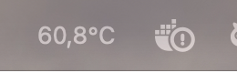
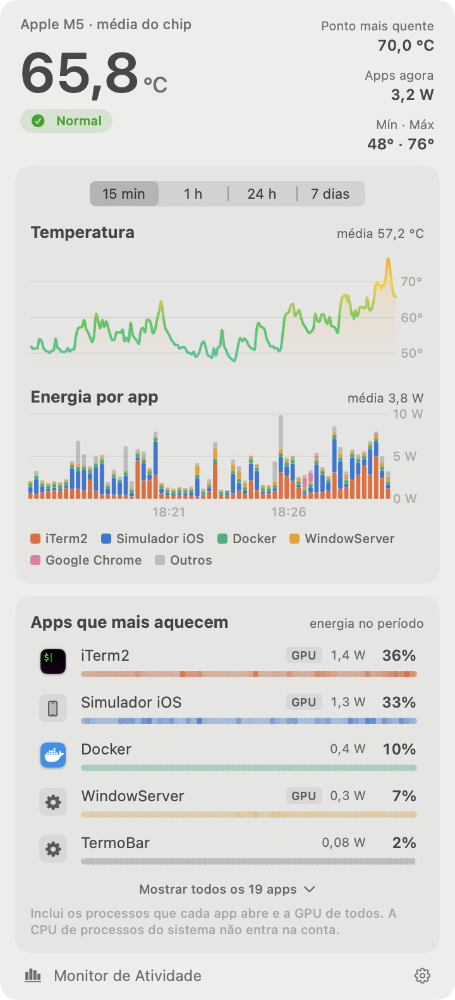
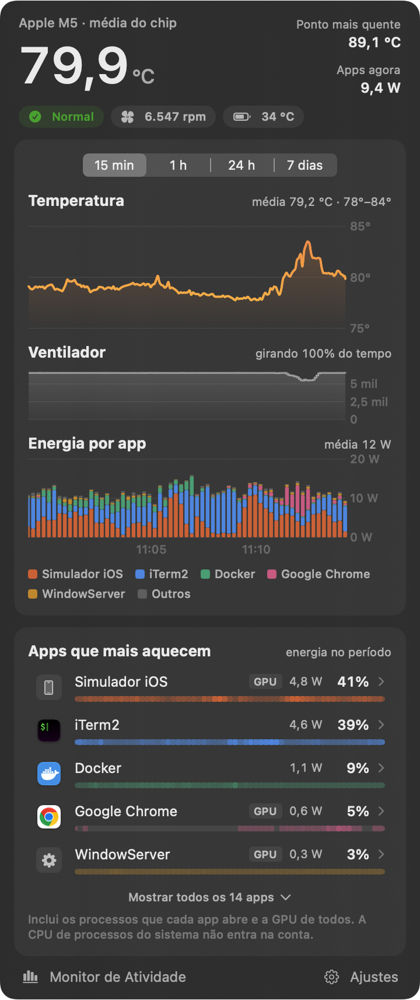
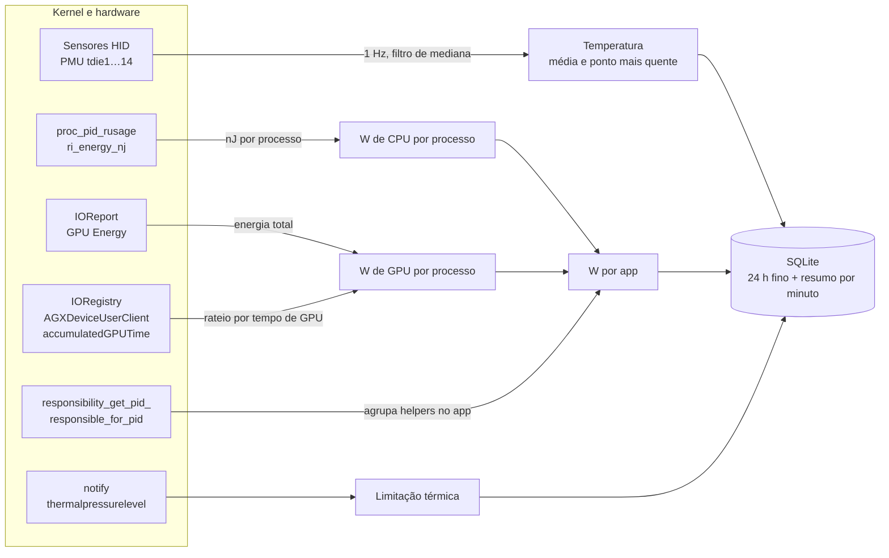
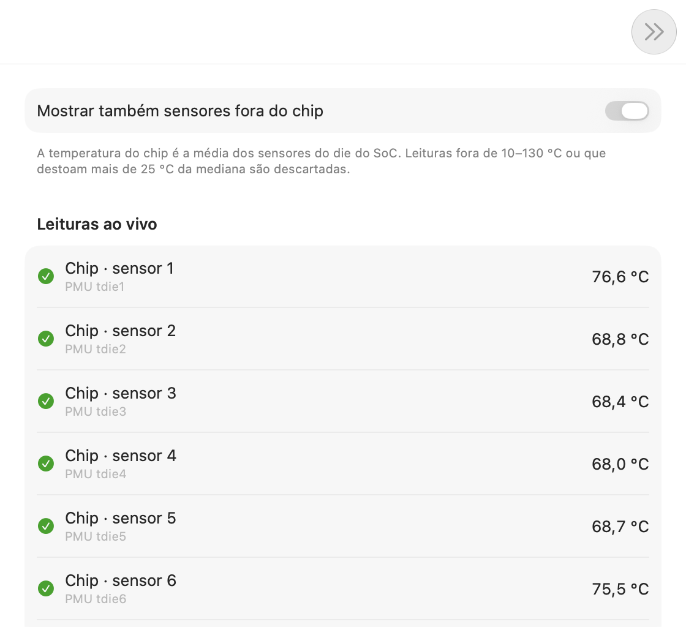
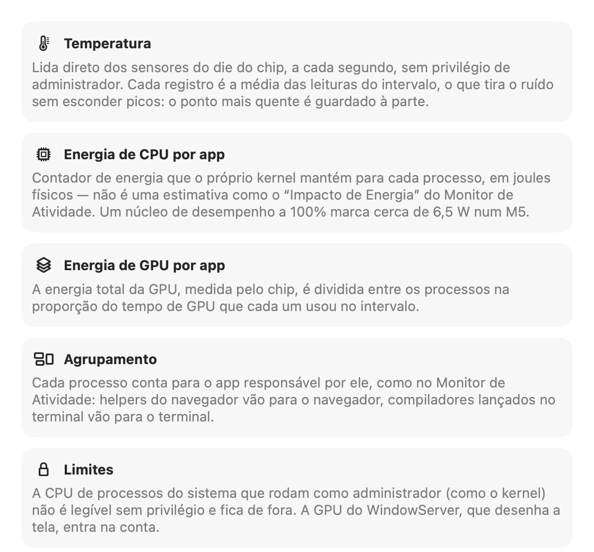
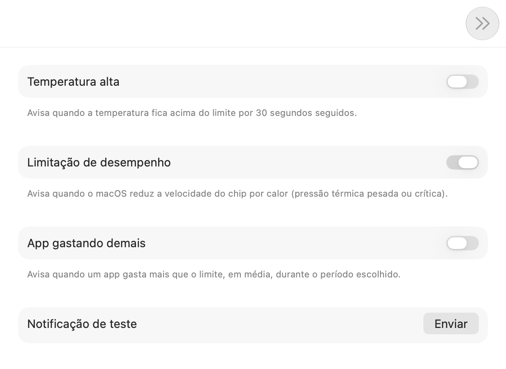
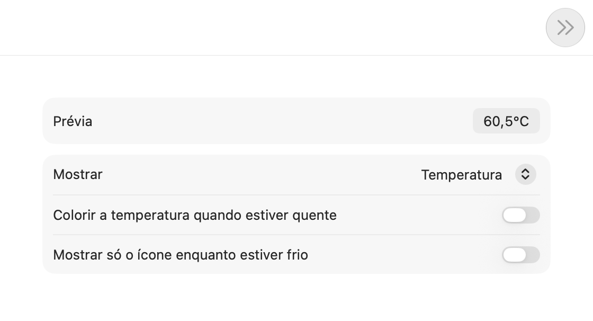

<p align="center">
  
</p>

<h1 align="center">TermoBar</h1>

<p align="center">
  <b>Descubra qual app está esquentando seu Mac — em watts, com histórico.</b>
</p>

<p align="center">
  <a href="https://github.com/gbrlrg/termo-bar/releases/latest"></a>
  
  
  <a href="LICENSE"></a>
</p>

<p align="center">
  <a href="README.md">English</a> · <b>Português</b>
</p>

TermoBar é um app nativo de barra de menus para Macs com Apple Silicon. Ele mostra a temperatura do chip na barra e, ao clicar, cruza essa temperatura com a energia que cada app está gastando: dá para ver o pico no gráfico e, logo abaixo, qual app causou.

Diferente do "Impacto de Energia" do Monitor de Atividade, que é uma nota relativa, o TermoBar mostra **watts de verdade**, lidos dos contadores de energia do kernel, com CPU e GPU separadas e o histórico de até 90 dias.

<p align="center">
  
</p>

<p align="center">
  
  &nbsp;&nbsp;
  
</p>

> [!NOTE]
> Esta é a primeira versão pública. O software é fornecido no estado em que se encontra, sem garantias; veja a [licença](LICENSE). Encontrou um problema? [Abra uma issue](https://github.com/gbrlrg/termo-bar/issues).

## Instalar

1. Baixe o `TermoBar-<versão>.dmg` da [última versão](https://github.com/gbrlrg/termo-bar/releases/latest) e abra.
2. Arraste o **TermoBar** para **Aplicativos** e abra o app por lá. A temperatura aparece na barra de menus.

Requer um Mac com Apple Silicon e macOS 15 ou superior. O app e o DMG são assinados com Developer ID e notarizados pela Apple, então abrem sem alertas do Gatekeeper.

Para atualizar, baixe a versão nova e substitua o app em Aplicativos. O histórico e os ajustes são mantidos.

## O que ele mostra

- **Temperatura do chip na barra**, em °C ou °F, com ou sem casa decimal.
- **Estado térmico do macOS** — de *Normal* a *Limitando desempenho* — direto da pressão térmica do kernel.
- **Gráfico de temperatura** com a linha colorida pela própria temperatura e os trechos de limitação térmica destacados.
- **Energia por app** em barras empilhadas, no mesmo eixo de tempo da temperatura.
- **Ranking "Apps que mais aquecem"**: watts médios, fatia da energia, se a GPU pesa, e uma linha do tempo de quando cada app esteve aberto e consumindo.
- **Processos de cada app agora**: clicando num app, a lista mostra os processos dele que estão consumindo, com nome legível, projeto e há quanto tempo rodam (ex.: *wrangler · dev · meu-site*, *Testes Swift*, um app no Simulador).
- **Períodos** de 15 min, 1 h, 24 h e 7 dias.
- **Alertas** de temperatura alta, limitação de desempenho e app gastando demais.
- **Exportação CSV** com CPU e GPU por app, leitura a leitura.

Passar o mouse sobre os gráficos mostra os valores do instante; passar o mouse num app destaca a cor dele no gráfico de energia, e clicar nele também abre os processos.

## Como cada número é medido

Precisão é o ponto central do TermoBar. Nenhuma das medições abaixo exige senha de administrador.



| Dado | De onde vem | Como é tratado |
|---|---|---|
| **Temperatura do chip** | Sensores do die do SoC (`PMU tdie*`) via `IOHIDEventSystemClient` | Lidos a cada segundo. Leituras fora de 10–130 °C ou que destoam mais de 25 °C da mediana são descartadas. Cada registro guarda a média das leituras do intervalo (tira ruído) e, à parte, o sensor mais quente (não esconde picos). |
| **CPU por app** | Contador de energia que o kernel mantém para cada processo (`proc_pid_rusage`, `ri_energy_nj`) | São nanojoules físicos — não o "Impacto de Energia" relativo do Monitor de Atividade. A diferença entre duas leituras dividida pelo tempo dá watts. |
| **GPU por app** | Energia total da GPU (`IOReport`, canal *GPU Energy*) + tempo de GPU de cada processo (`AGXDeviceUserClient` → `accumulatedGPUTime`) | A energia é dividida na proporção do tempo de GPU. O WindowServer recebe correção (veja abaixo). |
| **Agrupamento por app** | `responsibility_get_pid_responsible_for_pid` | Cada processo conta para o app responsável por ele, como no Monitor de Atividade: helpers do navegador vão para o navegador, compiladores lançados no terminal vão para o terminal. |
| **Limitação térmica** | Notificação `com.apple.system.thermalpressurelevel` | Cinco níveis (nominal, moderada, pesada, crítica, suspensão). A partir de *pesada* o macOS reduz a frequência do chip. |
| **Apps abertos e em uso** | `NSWorkspace` | Apps com janela/ícone no Dock e o app em primeiro plano em cada registro. |

### A correção do WindowServer

O tempo de GPU que o macOS registra inclui o tempo em que o trabalho espera na fila. Quando outro processo ocupa a GPU, o tempo do WindowServer (que desenha a tela) quase triplica sem que ele gaste mais energia — e um rateio ingênuo daria a ele quase metade do consumo de quem realmente está usando a GPU.

O TermoBar aprende quanto a GPU gasta quando só o WindowServer a usa e, quando há disputa, limita a parte dele a 1,5× esse valor. O restante vai para os processos que disputam a GPU, na proporção do tempo de cada um.

### Validação

Medições feitas num MacBook com Apple M5 e macOS 27:

| Teste | Resultado |
|---|---|
| Um núcleo de desempenho a 100% (`yes > /dev/null`) | **6,6 W** de CPU atribuídos ao processo |
| Laço de cálculo em Metal saturando a GPU (~17 W) | Rateio ingênuo: 1,6–2,8 W para a carga e 8–13 W para o WindowServer. **Com a correção: 13–16 W para a carga e 1,5 W para o WindowServer** |
| Atraso do contador de energia da GPU | Nenhum: sobe e desce no mesmo meio segundo da carga |
| Consumo do próprio TermoBar | **0,57%** de um núcleo em média, abaixo de 5 mW |

### Limites conhecidos

- A **CPU** de processos que rodam como outro usuário (kernel, WindowServer, daemons de root) não é legível sem privilégio e fica de fora. A **GPU** desses processos entra na conta.
- No macOS 27, o IOReport sem root só entrega a energia da **GPU**; CPU e Neural Engine vêm zerados. Por isso a CPU vem do contador por processo.
- A GPU por app é um rateio corrigido, não uma leitura direta: o macOS não expõe energia de GPU por processo.

## Ajustes

<p align="center">
  
  &nbsp;
  
</p>
<p align="center">
  
  &nbsp;
  
</p>

| Aba | Opções |
|---|---|
| **Geral** | Abrir ao iniciar sessão, temperatura exibida (média do chip ou ponto mais quente), unidade (°C/°F), casas decimais, intervalo de registro (2/5/10 s) |
| **Barra de menus** | Só temperatura, temperatura e watts, ícone e temperatura ou só ícone; colorir quando quente; mostrar só o ícone enquanto estiver frio |
| **Alertas** | Temperatura acima de um limite por 30 s; limitação de desempenho; app acima de X W em média por N minutos |
| **Sensores** | Leitura ao vivo de cada sensor, com nome legível e indicação de quais entram na média |
| **Dados** | Retenção (7/30/90 dias), exportar CSV, mostrar no Finder, apagar histórico |
| **Precisão** | A metodologia acima, dentro do app |
| **Sobre** | Versão, link para as versões no GitHub e um botão que copia as informações do sistema para pedidos de suporte |

## Histórico e privacidade

Tudo fica só neste Mac, em `~/Library/Application Support/TermoBar/history.sqlite`:

- **Leituras finas** (um registro a cada 2–10 s) por 24 horas.
- **Resumo por minuto** pelo período escolhido (7, 30 ou 90 dias).

Nenhum dado sai do computador. Não há telemetria, conta nem conexão com a internet.

## Perguntas frequentes

**Por que não está na Mac App Store?**
Para medir a energia de cada app, o TermoBar lê contadores de outros processos e usa APIs privadas do macOS. A App Store exige o App Sandbox, que bloqueia as duas coisas.

**Precisa de senha de administrador ou de um helper instalado?**
Não. Tudo é lido como usuário comum; nada é instalado fora do próprio app.

**Quanto ele gasta de bateria?**
Em média 0,57% de um núcleo, abaixo de 5 mW.

**Por que a temperatura é diferente da de outro app?**
Cada app escolhe sensores diferentes. O TermoBar mostra por padrão a média dos sensores do die do chip, que é a mais estável; em Ajustes › Geral dá para trocar pelo ponto mais quente, que reage mais rápido a picos. A aba Sensores mostra cada leitura.

**Funciona em Mac com Intel?**
Não. Os sensores e contadores usados só existem no Apple Silicon.

**Por que alguns processos do sistema não aparecem com CPU?**
O macOS não deixa um app comum ler a energia de CPU de processos de outros usuários, como o kernel e o WindowServer. A GPU deles entra na conta. Veja [Limites conhecidos](#limites-conhecidos).

## Desinstalar

1. Se ele abre ao iniciar sessão, desligue isso antes (engrenagem › Abrir ao iniciar sessão).
2. Saia do TermoBar: clique na temperatura na barra, depois na engrenagem › Sair do TermoBar.
3. Apague o `TermoBar.app` de Aplicativos.
4. Para apagar também o histórico e os ajustes:

```sh
rm -rf ~/Library/Application\ Support/TermoBar
defaults delete br.com.gbrlrg.termobar
```

## Compilar a partir do código

Veja [docs/DEVELOPMENT.md](docs/DEVELOPMENT.md): como compilar, testar, distribuir e como o código está organizado.

## Licença

O código está disponível sob a [PolyForm Noncommercial 1.0.0](LICENSE): você pode usar, estudar, modificar e redistribuir o TermoBar para fins **não comerciais** (uso pessoal, estudo, pesquisa, organizações sem fins lucrativos e instituições públicas). Uso comercial não é permitido sem autorização por escrito.

Por ter essa restrição, o TermoBar é *source-available*, não open source na definição da OSI.

Copyright © 2026 Gabriel Rigon.
